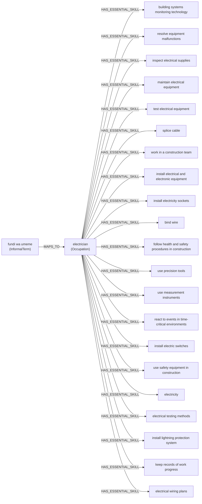

# Worked enrichment example

Generated by `scripts/enrichment_example.py --group G0004` from commit `aa2771a` **with uncommitted changes**. Development split. Group IDs and variants are dataset bookkeeping; the enricher sees only the profile.

## Before enrichment (known_alias profile)

| Field | Value |
|---|---|
| worker_id | `3917d39f-d0c0-46c2-aa34-9158711f68f3` |
| biography | Niko Nyeri, ni fundi wa umeme. Experience miaka 20, rates from KSh 2000. |
| skills | fundi wa umeme |
| location | Nyeri |
| availability | Part-time |
| rate_expectation (KES/day) | 2000.0 |

## After enrichment (ProfileEnricher)

| Step | Result |
|---|---|
| Informal term matched | fundi wa umeme (`term:fundi umeme`) |
| MAPS_TO occupation | electrician (ESCO 7411.1, `http://data.europa.eu/esco/occupation/4910419f-b4af-4f59-b544-9dbebc8a74f0`) |
| Skills inferred | 21 essential skills of electrician |
| Stated skills mapped | 0 |
| Unmapped text | none |

### Inferred skills, each with the graph path that produced it

| # | Skill | ESCO URI | Graph path |
|---|---|---|---|
| 1 | building systems monitoring technology | `http://data.europa.eu/esco/skill/0e8d16c9-e2db-4862-ac06-1567f01ef806` | fundi wa umeme → *MAPS_TO* → electrician → *HAS_ESSENTIAL_SKILL* → building systems monitoring technology |
| 2 | resolve equipment malfunctions | `http://data.europa.eu/esco/skill/1de6b87b-2c7d-49aa-bcc0-3b2ef75f064f` | fundi wa umeme → *MAPS_TO* → electrician → *HAS_ESSENTIAL_SKILL* → resolve equipment malfunctions |
| 3 | inspect electrical supplies | `http://data.europa.eu/esco/skill/2179e0fd-7431-41a3-bbf4-76451c615ce2` | fundi wa umeme → *MAPS_TO* → electrician → *HAS_ESSENTIAL_SKILL* → inspect electrical supplies |
| 4 | maintain electrical equipment | `http://data.europa.eu/esco/skill/386774ac-fe5b-431a-b485-9aec0bf5c09e` | fundi wa umeme → *MAPS_TO* → electrician → *HAS_ESSENTIAL_SKILL* → maintain electrical equipment |
| 5 | test electrical equipment | `http://data.europa.eu/esco/skill/3f6dc31c-ceef-4e93-9d8a-b4b862cf9b51` | fundi wa umeme → *MAPS_TO* → electrician → *HAS_ESSENTIAL_SKILL* → test electrical equipment |
| 6 | splice cable | `http://data.europa.eu/esco/skill/4a30802f-827c-4706-9099-de85beee6cb5` | fundi wa umeme → *MAPS_TO* → electrician → *HAS_ESSENTIAL_SKILL* → splice cable |
| 7 | work in a construction team | `http://data.europa.eu/esco/skill/4fa2d6ba-4fff-4f21-bddd-4a54ae840955` | fundi wa umeme → *MAPS_TO* → electrician → *HAS_ESSENTIAL_SKILL* → work in a construction team |
| 8 | install electrical and electronic equipment | `http://data.europa.eu/esco/skill/52797dce-911c-4e6d-b0cb-491f6469014f` | fundi wa umeme → *MAPS_TO* → electrician → *HAS_ESSENTIAL_SKILL* → install electrical and electronic equipment |
| 9 | install electricity sockets | `http://data.europa.eu/esco/skill/52d6eb67-56c0-4ad7-b5c2-71e7c2362ece` | fundi wa umeme → *MAPS_TO* → electrician → *HAS_ESSENTIAL_SKILL* → install electricity sockets |
| 10 | bind wire | `http://data.europa.eu/esco/skill/7f67f82e-73c5-4dc0-b506-8e0b1a84f614` | fundi wa umeme → *MAPS_TO* → electrician → *HAS_ESSENTIAL_SKILL* → bind wire |
| 11 | follow health and safety procedures in construction | `http://data.europa.eu/esco/skill/86df7af2-f9f3-4c06-a500-7f1fba9e78fe` | fundi wa umeme → *MAPS_TO* → electrician → *HAS_ESSENTIAL_SKILL* → follow health and safety procedures in construction |
| 12 | use precision tools | `http://data.europa.eu/esco/skill/a99c6783-50c0-4f7a-99df-bf93429ef6dc` | fundi wa umeme → *MAPS_TO* → electrician → *HAS_ESSENTIAL_SKILL* → use precision tools |
| 13 | use measurement instruments | `http://data.europa.eu/esco/skill/b92758d4-4591-4df1-9ceb-f907aa71ebd9` | fundi wa umeme → *MAPS_TO* → electrician → *HAS_ESSENTIAL_SKILL* → use measurement instruments |
| 14 | react to events in time-critical environments | `http://data.europa.eu/esco/skill/be7c80ee-0b7a-455c-8928-055cfa65076c` | fundi wa umeme → *MAPS_TO* → electrician → *HAS_ESSENTIAL_SKILL* → react to events in time-critical environments |
| 15 | install electric switches | `http://data.europa.eu/esco/skill/c3d1ada5-1d97-4a23-be2a-9ff39296775b` | fundi wa umeme → *MAPS_TO* → electrician → *HAS_ESSENTIAL_SKILL* → install electric switches |
| 16 | use safety equipment in construction | `http://data.europa.eu/esco/skill/c643e59b-d74c-4f44-b76e-6e1d96c05ec4` | fundi wa umeme → *MAPS_TO* → electrician → *HAS_ESSENTIAL_SKILL* → use safety equipment in construction |
| 17 | electricity | `http://data.europa.eu/esco/skill/c8ac1986-38fa-43b2-89dc-50a4beeb420e` | fundi wa umeme → *MAPS_TO* → electrician → *HAS_ESSENTIAL_SKILL* → electricity |
| 18 | electrical testing methods | `http://data.europa.eu/esco/skill/c8bd9f9f-0ec6-447a-ab78-ad6eeeed9aa8` | fundi wa umeme → *MAPS_TO* → electrician → *HAS_ESSENTIAL_SKILL* → electrical testing methods |
| 19 | install lightning protection system | `http://data.europa.eu/esco/skill/cbcce641-a001-47eb-b15b-476da8dfc9ce` | fundi wa umeme → *MAPS_TO* → electrician → *HAS_ESSENTIAL_SKILL* → install lightning protection system |
| 20 | keep records of work progress | `http://data.europa.eu/esco/skill/ccfbdaad-b91d-4bfe-bd0e-d30b33587f19` | fundi wa umeme → *MAPS_TO* → electrician → *HAS_ESSENTIAL_SKILL* → keep records of work progress |
| 21 | electrical wiring plans | `http://data.europa.eu/esco/skill/d15e92c4-c8dc-48cd-a1f6-94fe13347f87` | fundi wa umeme → *MAPS_TO* → electrician → *HAS_ESSENTIAL_SKILL* → electrical wiring plans |

### Figure

## The same group under both enrichers

All variants share the base profile; only the wording differs. NullEnricher is the no-knowledge-graph configuration: it keeps listed skills as literal text and maps nothing.

| Variant | Skills listed | KG: occupation | KG: stated (mapped or literal) | KG: inferred | KG: unmapped | No KG: skills (all literal text) |
|---|---|---|---|---|---|---|
| formal | install electric switches, install electrical and electronic equipment … | electrician | 6 | 15 | none | 6 |
| known_alias | fundi wa umeme | electrician | 0 | 21 | none | 1 |
| held_out | fundi wa stima | none | 1 | 0 | fundi wa stima | 1 |
| minimal | fundi wa umeme | electrician | 0 | 21 | none | 1 |

## Occupation mapping over the whole development split

Each development worker is enriched with ProfileEnricher, and the occupation(s) reached are compared with the generator's ground-truth occupation (`ground_truth/worker_truth.csv`). This checks the vocabulary mapping, not recommendation quality; no job is scored. Only development-split rows are used.

| Variant | Workers | Reached the true occupation only | Reached no occupation | Reached a wrong occupation | Alias kept as unmapped text |
|---|---|---|---|---|---|
| formal | 64 | 64/64 | 0/64 | 0/64 | — |
| known_alias | 64 | 64/64 | 0/64 | 0/64 | 0/64 |
| held_out | 24 | 0/24 | 24/24 | 0/24 | 24/24 |
| minimal | 64 | 64/64 | 0/64 | 0/64 | 0/64 |
